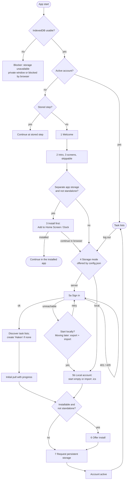

# 6. Runtime View

## First start and setup

Runs when the meta database has no active account
([ADR](adr/ADR-20261103-first-start-setup.md)). Every step is stored; a reload
resumes at the same step.

Switching from the browser tab to the installed app is optional. Whether the
app sees the tab's data depends on the platform:

| Platform | Tab and app share storage | Switching to the app |
| --- | --- | --- |
| Chromium (Chrome, Edge), Firefox Android, Samsung Internet | Yes | Resumes at the same step, same data and session |
| iOS, iPadOS (any browser), macOS Safari ("Add to Dock") | No | App starts with an empty store: setup from step 1, new sign-in |

The second group is called *separate app storage* below.

| Step | Content | Leave | Failure |
| --- | --- | --- | --- |
| 1 Welcome | Name, one sentence. Secondary action "Used haken here before?": browser storage may have been cleared; signing in restores from the server, a local account only from `.ics` | Start | — |
| 2 Intro | Offline first, sync, order by drag and drop. Original illustrations | Next, Skip | — |
| 3 Install first (separate app storage only) | Data set up in this tab stays in the tab; Safari clears a site's storage after 7 days unused. Detected in one tested function from the user agent, since no feature test exists | Installed, Continue in browser | Continue in browser: server mode loses nothing (app signs in and pulls; the tab's outbox syncs when the tab is used again). Local mode: tab and app are separate stores, transfer only via `.ics` |
| 4 Storage mode | "Sync with my server" or "Only on this device". Only the modes in `config.json` `accounts`; a single mode skips the step | Choice, Back | — |
| 5a Sign in | Username, password (`autocomplete` so password managers work) to `POST /api/session` on the origin the app was loaded from. The app never stores the password | Sign in, Back | 401: message, retry. 429: wait time. Unreachable: offer local start, with the warning that moving to the server later needs export and import |
| 5a Lists | `PROPFIND` calendar home, list `VTODO` collections. None: `MKCALENDAR` "Haken" (not translated) | automatic | Error: retry, back |
| 5a Pull | Into the account database; sync token stored only after completion, so a resumed pull starts over safely | automatic | Offline: resumes at next start |
| 5b Local | Create account database with the list "Haken"; warn "no server copy, export regularly" and "moving to a server later needs export and import". Optional `.ics` import. Demo build also shows "demo, do not store real data" | Start empty, Import | Import error: shows invalid items, imports the rest only on confirmation |
| 6 Install | Chromium: own button calling the saved `beforeinstallprompt`. Others: short instruction. Skipped if not possible | Install, Later | Dismissed: not offered again; the browser's own install entry still works |
| 7 Persist | Button calling `navigator.storage.persist()` (user gesture; after install it is usually granted) | Allow, Later | Denied: hint and export reminder, no blocker |

One account is active at a time. *Log out* in Settings ends it
([Auth](adr/ADR-20261103-authentication.md)) and returns to step 4; the next
user signs in there. If the same user had logged out keeping data, their
account database is reused and its outbox resumes.
