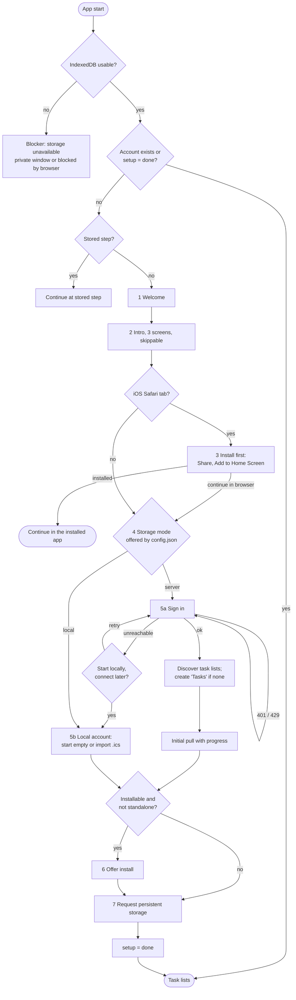

# 6. Runtime View

## First start and setup

Runs when the meta database has no completed setup and no account
([ADR](adr/ADR-20261103-first-start-setup.md)). Every step is stored; a reload
or a switch to the installed app resumes at the same step.

| Step | Content | Leave | Failure |
| --- | --- | --- | --- |
| 1 Welcome | Name, one sentence. Secondary action "Used haken here before?": browser storage may have been cleared; signing in restores from the server, a local account only from `.ics` | Start | — |
| 2 Intro | Offline first, sync, order by drag and drop. Original illustrations | Next, Skip | — |
| 3 Install first (iOS only) | Safari tab and home-screen app have separate storage; Safari clears it after 7 days unused | Installed, Continue in browser | — |
| 4 Storage mode | "Sync with my server" or "Only on this device". Only the modes in `config.json` `accounts`; a single mode skips the step | Choice, Back | — |
| 5a Sign in | Username, password (`autocomplete` so password managers work) to `POST /api/session`. The app never stores the password | Sign in, Back | 401: message, retry. 429: wait time. Unreachable: offer local start |
| 5a Lists | `PROPFIND` calendar home, list `VTODO` collections. None: `MKCALENDAR` "Tasks" | automatic | Error: retry, back |
| 5a Pull | Into the account database; sync token stored only after completion, so a resumed pull starts over safely | automatic | Offline: resumes at next start |
| 5b Local | Create account database; warn "no server copy, export regularly". Optional `.ics` import. Demo build also shows "demo, do not store real data" | Start empty, Import | Import error: shows invalid items, imports the rest only on confirmation |
| 6 Install | Chromium: own button calling the saved `beforeinstallprompt`. Others: short instruction. Skipped if not possible | Install, Later | Dismissed: offered again from settings |
| 7 Persist | Button calling `navigator.storage.persist()` (user gesture; after install it is usually granted) | Allow, Later | Denied: hint and export reminder, no blocker |

Adding an account later from the settings runs steps 4–5.
