# UI sketches

Static renders of the design canvas "Haken UI Sketches". They illustrate
[chapter 8](../08-crosscutting-concepts.md), which is binding where the two
differ. The copy is German example text; the app takes all copy from message
keys.

Rendered with the default accent (`#1F4D45`, dark `#618F86`) and the real logo.

| Mobile | |
| --- | --- |
| 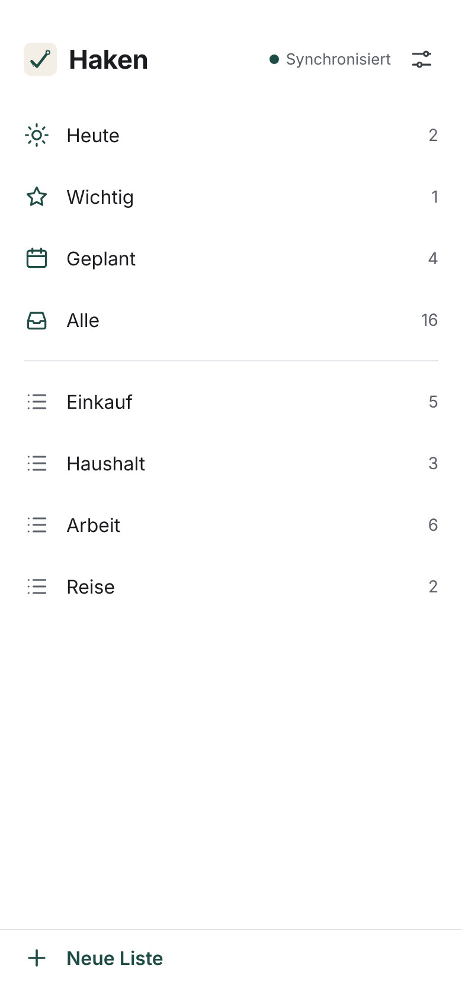 | 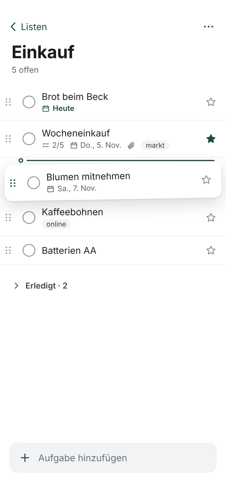 |
| Lists | List, task being dragged |
| 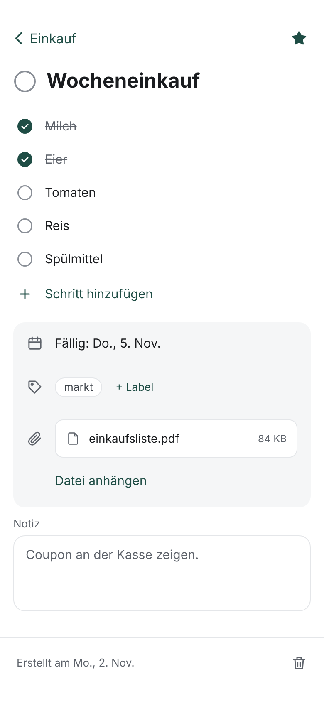 | 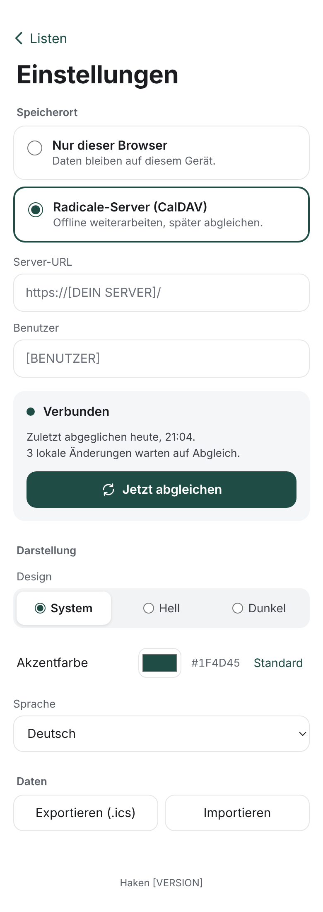 |
| Task | Settings |

| Dark | |
| --- | --- |
| 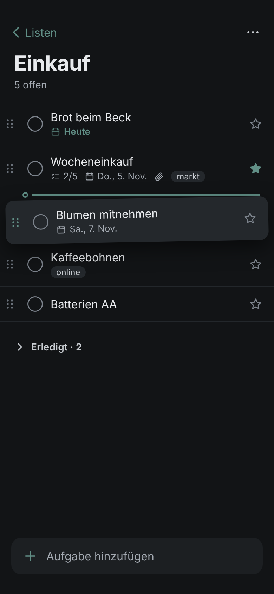 | 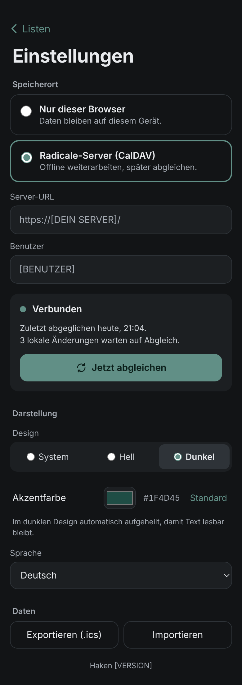 |

Desktop, three panes:

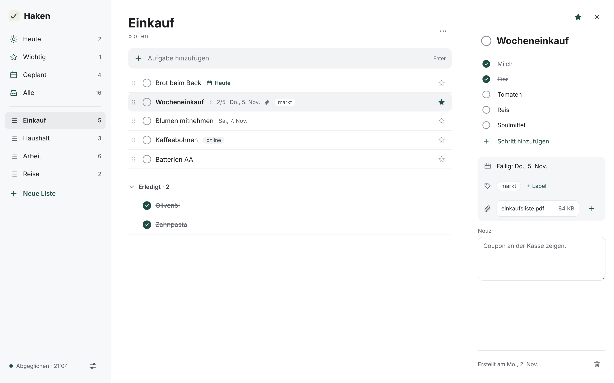

Known differences to chapter 8: the settings sketches still show the old
storage selector instead of the read-only account block with *Log out*; the list sketches show grips (rows are dragged as a whole now) and the desktop text size.

## App screens

Screenshots of the running app (phone, light, English, synthetic data),
rendered by `SCREENS=1 npx playwright test screens` after `make gateway`.

| Setup | | |
| --- | --- | --- |
| 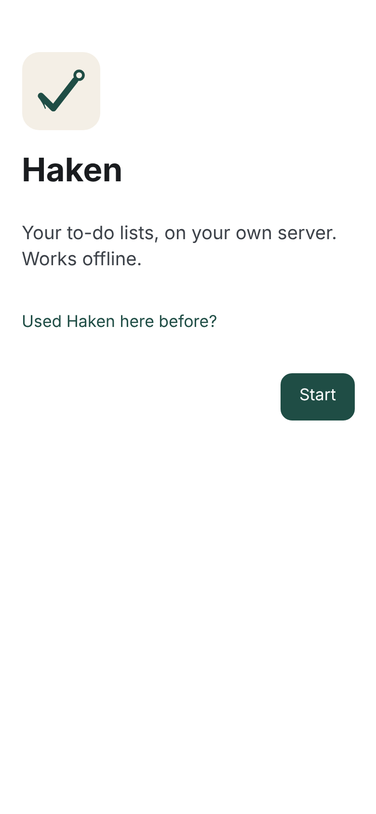 | 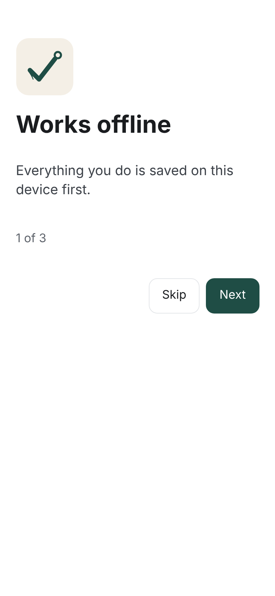 | 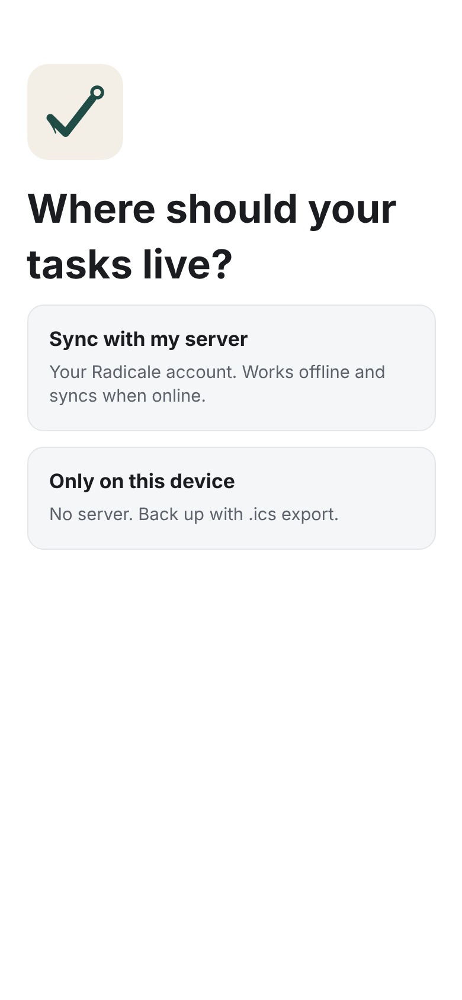 |
| Welcome | Intro | Storage |
| 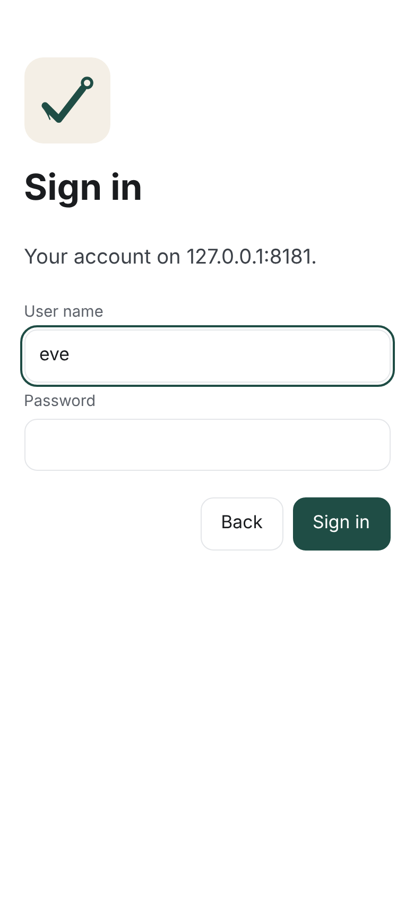 | 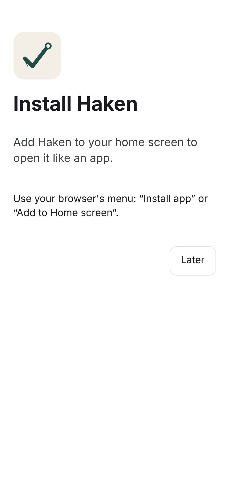 | 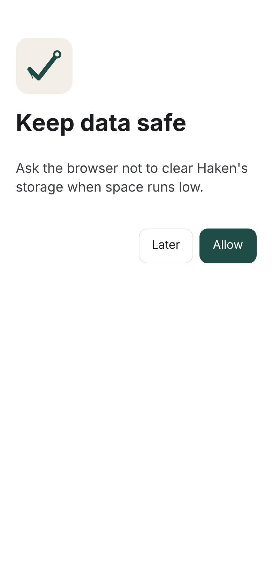 |
| Sign in | Install | Keep data |

| States | | |
| --- | --- | --- |
| 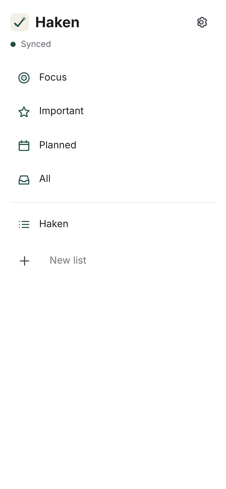 | 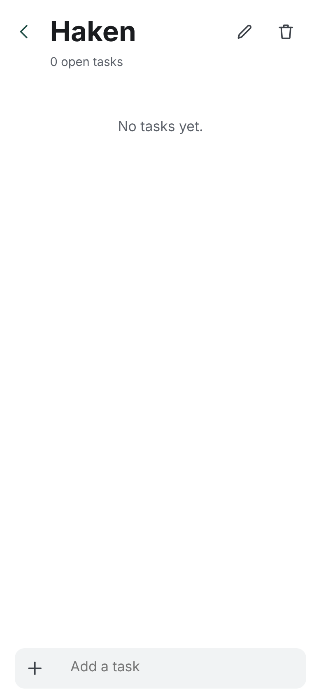 | 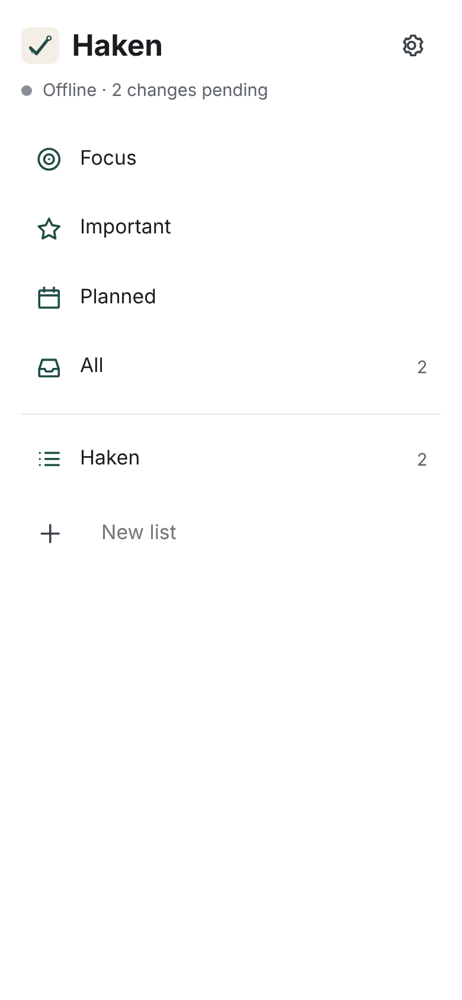 |
| Lists | Empty list | Offline, changes pending |
| 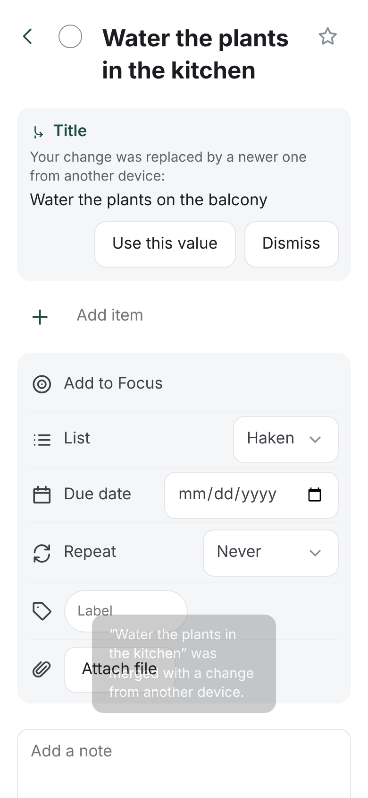 | 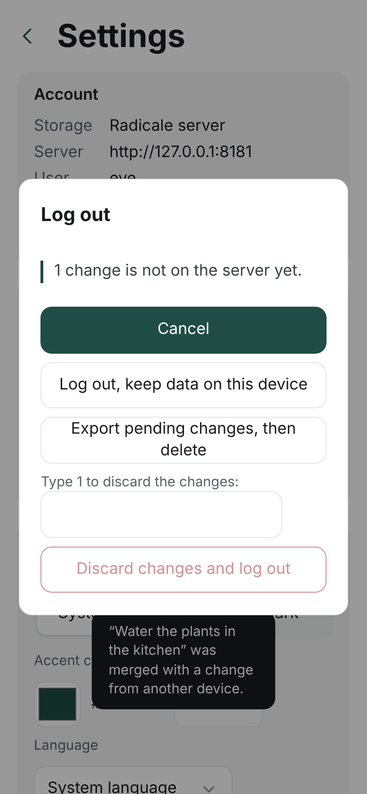 | |
| Conflict note and notice | Logout with pending changes | |
